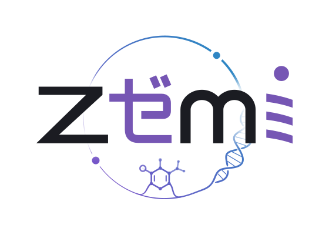

<p align="center">
  <picture>
    <source media="(prefers-color-scheme: dark)" srcset="docs/src/assets/hero-dark.svg">
    
  </picture>
</p>

<p align="center">
  <a href="https://github.com/kahliburke/Zemi.jl/actions/workflows/CI.yml"></a>
  <a href="https://kahliburke.github.io/Zemi.jl/"></a>
  <a href="LICENSE"></a>
</p>

A knowledge base for a research group: papers read in full and searchable by meaning, findings
backed by evidence, a tutor for each paper, and projects that people and agents work on. Named
after the ゼミ (*zemi*), a Japanese university research seminar.

<picture>
  <source media="(prefers-color-scheme: dark)" srcset="https://github.com/kahliburke/Zemi.jl/releases/download/docs-assets/front-dark.png">
  
</picture>

- **Papers**: arXiv papers, PDFs and codebases, parsed, summarized section by section, and embedded
  in several layers. Hybrid keyword and semantic search.
- **A site**: paper pages, topics, a timeline, a landscape against the group's focus areas, an arXiv
  watch, and a daily paper with an analysis.
- **A tutor** per paper, pitched to the reader's background.
- **Findings** that cite their evidence, and **projects** whose task boards people and agents share.
- **Agents** use all of it through MCP or [Kaimon](https://github.com/kahliburke/Kaimon.jl).
- **Solo or shared**: one person on a laptop, or a signed-in group on a server, sharing what they
  read as datasets.

**[Guide](https://kahliburke.github.io/Zemi.jl/)** ·
**[Demo](https://kahliburke.github.io/Zemi.jl/demo/)**

## Quick start

Julia 1.12+, plus Ollama (`qwen3-embedding:4b`), Qdrant and `mutool` to read papers
([requirements](https://kahliburke.github.io/Zemi.jl/installation)).

```sh
git clone https://github.com/kahliburke/Zemi.jl.git
cd Zemi.jl
./zemi
```

The site is served at http://localhost:8000; its front page leads to Setup.

```julia
using Zemi
db = kb()
ingest!(db, ["1706.03762"])
search(db, "attention without recurrence")
```

## License

MIT
